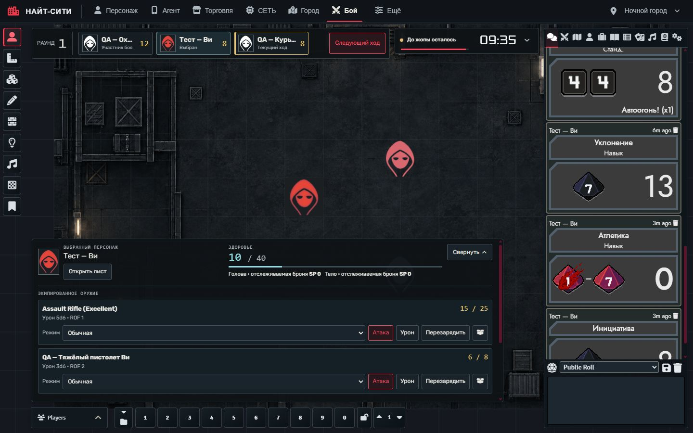
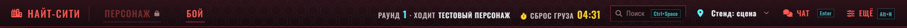
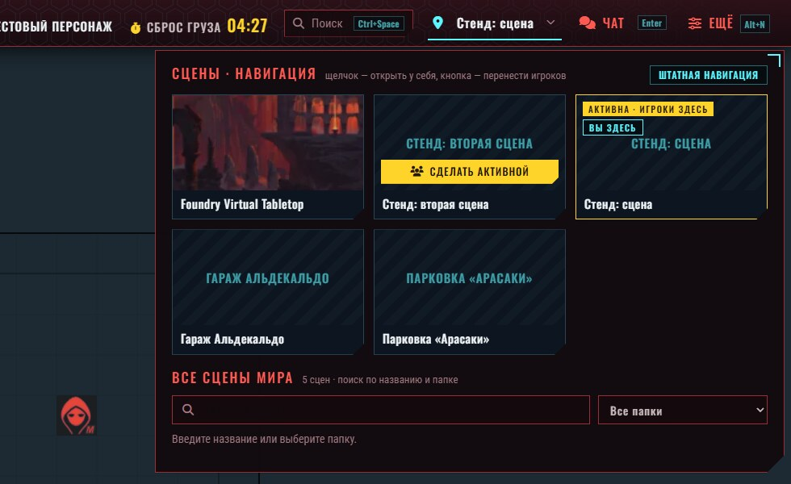
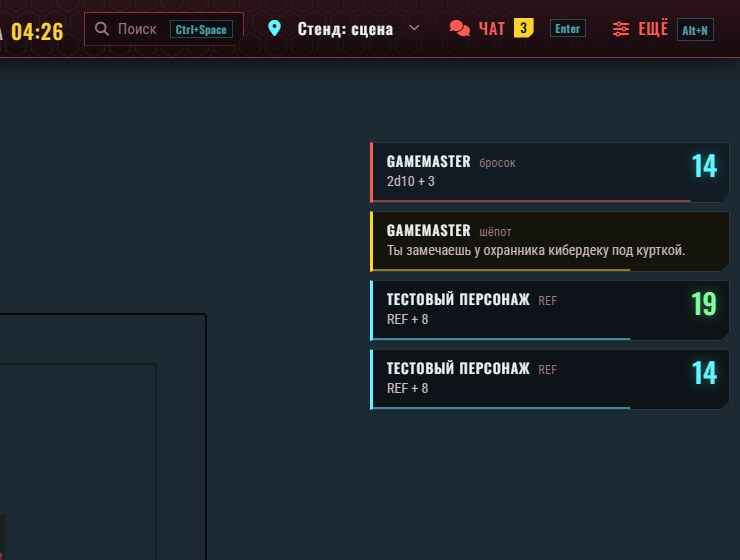
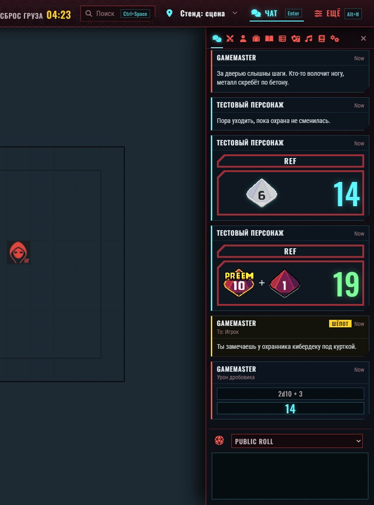
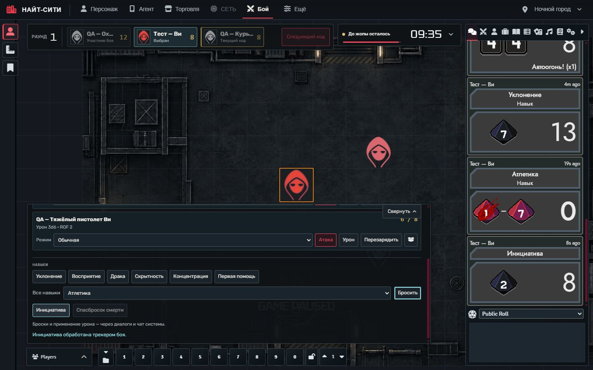

# Найт-Сити — общий интерфейс

**Версия 0.5.4 — верхняя панель в стиле Cyberpunk 2077: сайдбар шторкой, лента, чат, карточки сцен и поиск** для **Foundry VTT v12** и **Cyberpunk RED Core** (`cyberpunk-red-core`). Модуль добавляет общую навигацию и компактное оформление штатного интерфейса. Нижняя панель игроков получила отдельные сворачивание, скрытие и перетаскивание с личным сохранением положения. REDLINE COMBAT 0.3.1 управляет собственным боевым доком и масштабом; Night City UI сохраняет совместимость с ним и с прежним REDLINE 0.2.x.

[Релиз v0.5.4](https://github.com/Defaulter444/night-city-ui/releases/tag/v0.5.4) · [История изменений](CHANGELOG.md) · [Примечания к релизу](RELEASE-NOTES.md) · [Сообщить об ошибке](https://github.com/Defaulter444/night-city-ui/issues)



Этот снимок показывает прежнюю карточку REDLINE 0.2.x. Новый Blackglass Dock представлен в [руководстве REDLINE](https://github.com/Defaulter444/CPR-RED-COMBAT/blob/main/foundry/redline-combat/README.md).

## Установка

В **Add-on Modules → Install Module → Manifest URL** вставьте:

```text
https://raw.githubusercontent.com/Defaulter444/night-city-ui/main/module.json
```

Установите пакет и включите **Найт-Сити — общий интерфейс** через **Manage Modules** в мире Cyberpunk RED. Перед обновлением рабочей кампании рекомендуется проверить модуль в отдельном тестовом мире.

Для ручной установки скачайте [night-city-ui.zip v0.5.4](https://github.com/Defaulter444/night-city-ui/releases/download/v0.5.4/night-city-ui.zip), остановите сервер и распакуйте папку `night-city-ui` в `Data/modules`, чтобы manifest оказался в `Data/modules/night-city-ui/module.json`. Перезапустите Foundry и включите модуль. При обновлении сохраните предыдущую папку для отката и замените её новой целиком. После обновления с 0.3.x перезапустите сервер Foundry: в 0.4.0 и 0.5.0 добавились файлы стилей, а их список Foundry читает только при запуске.

Поддерживается только **Foundry v12**. Кроме системы Cyberpunk RED, интеграции необязательны: для действий персонажа нужен [REDLINE COMBAT](https://github.com/Defaulter444/CPR-RED-COMBAT), для таймера — DEADLINE, для поиска — Quick Insert. С Dice So Nice лента сообщений ждёт, пока упадут кубики. Версия 0.5.4 проверена с REDLINE 0.5.2 и сохраняет поддержку Blackglass Dock REDLINE 0.3.x и прежней карточки REDLINE 0.2.x. Отсутствующие модули не получают фиктивных рабочих команд. ZIP не содержит Foundry, систему, игровые миры или сторонние модули.

## Верхняя панель и сайдбар-шторка



Панель оформлена как меню Cyberpunk 2077: заглавные красные вкладки с подчёркиванием, шрифты Oswald и Roboto Condensed (SIL OFL, лежат в модуле, см. `ASSET_CREDITS.md`).

- **Разделы.** Бирюзовой подсвечивается вкладка раздела, чьё окно сейчас впереди. Пункта модуля, который не установлен, нет вовсе. Если модуль есть, а доступа нет, пункт тусклый, с замком, причина видна в подсказке.
- **Статус боя.** В бою на текущей сцене панель показывает «РАУНД 3 · ХОДИТ ВЕСПЕР», до первого раунда — «ПОДГОТОВКА К БОЮ». Ход скрытого участника игроки видят как «ХОД СКРЫТ». Щелчок открывает трекер.
- **Таймер DEADLINE.** Подпись и время. На паузе таймер тусклый, в последнюю минуту красный и пульсирует, по окончании пишет «ВРЕМЯ ВЫШЛО». Таймер виден тем, кому его показывает DEADLINE, а щелчок мастера открывает управление таймером.
- **Поиск.** Открывает Quick Insert с курсором в поле. На кнопке подписана его клавиша. Окно Quick Insert получает палитру панели.
- **Сцены.** Щелчок по названию сцены открывает карточки сцен навигации с превью и метками «Активна · игроки здесь» и «Вы здесь». Щелчок по карточке открывает сцену у себя. Кнопка мастера «Сделать активной» сразу переносит игроков. Ниже мастер ищет по всем сценам мира, с фильтром папки.



- **Чат и сайдбар.** Сайдбар Foundry убран в шторку, и сцена видна во всю ширину. «ЧАТ» в панели открывает шторку на чате, счётчик на кнопке показывает непрочитанное и желтеет, если есть шёпот вам. **Enter** открывает чат с курсором в поле ввода, «БОЙ» открывает шторку на трекере. Esc, ✕, повторный щелчок и нажатие на сцену закрывают шторку. Сам сайдбар штатный: модули в чате и списках работают как раньше, правый щелчок по вкладке выносит её в окно, актёров можно перетаскивать на сцену прямо из шторки.
- **Лента.** Пока чат не на экране, новые сообщения коротко всплывают справа под панелью. Цвет полосы зависит от того, кто пишет: игроки, мастер, шёпот или служебное сообщение модуля. У броска CPR крупно виден итог, крит подсвечен. Скрытый бросок игрок видит без итога. Карточка живёт 8 секунд, под курсором ждёт, а щелчок открывает чат.



- **Чат в стиле 2077.** В шторке и в вынесенном окне чата сообщения — тёмные карточки с цветной полосой. У бросков CPR красная рамка и крупный итог: обычный бирюзовый, критический успех зелёный, провал красный. Разметку системы модуль не меняет, тема задаётся её же CSS-переменными.



На узких экранах статус и поиск сокращаются, а вкладки становятся значками. Уступают место имя участника и название сцены: вкладки, таймер и кнопки не сжимаются.

## Навигация и Blackglass

Верхнее меню подписано: **Персонаж / Агент / Торговля / СЕТЬ / Город / Бой**. Доступность пунктов зависит от установленных модулей и прав пользователя. Кнопка **«Город»** появляется у игрока, когда Атлас явно разрешает ему открытие через `api.canOpen()`. Старые версии Атласа сохраняют доступ только ведущему. Общая тема охватывает основные окна Agent, Market, Netrunning, Atlas и лист персонажа CPR; это не полный редизайн всех экранов каждого модуля.

В режиме **«Просторный интерфейс Foundry»**:

- Верхняя панель занимает **58 px**. Имя сцены открывает карточки сцен; прежнее меню сцен Foundry с контекстными командами открывает кнопка **«Штатная навигация»** в них.
- Таймер DEADLINE показывается в самой панели. Собственная карточка DEADLINE возвращается, если выключить тему.
- **REDLINE COMBAT 0.3.1:** очередь начатого боя, боевой док, масштаб, прокрутку и сворачивание оформляет сам REDLINE. По умолчанию используется масштаб 80%; шестерёнка дока открывает личную настройку 55–125%. Night City UI не добавляет вторую кнопку сворачивания и не ограничивает док старой высотой карточки. После отключения слоя Night City UI собственная шапка и расположение REDLINE остаются доступны.
- **REDLINE COMBAT 0.2.x:** сохраняется прежняя горизонтальная очередь **64 px** и карточка **540 × 80 px**. **«Действия»** раскрывает область с запрошенной высотой **340 px**; полоса целей добавляет **32 px**. При нехватке высоты действия прокручиваются вертикально, цели — горизонтально; кнопка **«Свернуть»** остаётся доступной.

Инструменты слева раскрываются при наведении или фокусе клавиатуры. Панель игроков по умолчанию занимает только компактный заголовок; отдельная стрелка раскрывает и сворачивает её содержимое. Панель можно перетащить за заголовок. Обычный щелчок по заголовку сохраняет штатное переключение показа отключившихся пользователей, а контекстные команды строк остаются у Foundry. Макросы сохраняют десять ячеек, блокировку, каталог и страницы; на узком экране они переходят в два ряда. Сайдбар по умолчанию убран в шторку (см. выше); галочка **«Сайдбар шторкой из панели»** в «Ещё» возвращает его на место.

## Действия персонажа

Выберите своего персонажа в REDLINE. Доступны экипированное оружие, режим, **Атака / Урон / Перезарядить / Выбрать патроны**, быстрые навыки, список всех навыков, инициатива и спасбросок смерти. В REDLINE 0.3.x эти команды находятся в собственном Blackglass Dock. В REDLINE 0.2.x нажмите **«Действия»** для раскрытия прежней карточки.

Команды выполняет адаптер REDLINE для **CPR 0.92.4**. Атаки и урон открывают системные диалоги и карточки чата; боеприпасы используют штатные расход, `reload` и `load`. **Кнопка «Урон» не применяет его к цели автоматически** — применяйте результат штатными командами системы в чате. Недоступные действия имеют поясняющую подсказку, а выполняемая команда временно блокирует повторный запуск. Полный порядок работы описан в [руководстве REDLINE](https://github.com/Defaulter444/CPR-RED-COMBAT/blob/main/foundry/redline-combat/README.md).

Night City UI отвечает за общую навигацию, оформление Foundry и адаптацию прежних панелей. Новый Blackglass Dock управляет своим положением самостоятельно. Формулы боя, покупки, NET и игровые документы остаются у системы и исходных модулей. В сборке нет синхронных запросов защиты между клиентами и автоматизации NET.



## Личные настройки и возврат к исходному интерфейсу

Меню **«Ещё»** содержит личные настройки просторного интерфейса, общей темы, повторных значков, контекстных боевых панелей, **«Сайдбар шторкой из панели»** и **«Показывать панель игроков»**. Клавиша Enter, которая открывает чат, переназначается в настройках управления Foundry («Найт-Сити — написать в чат»). Снятая галочка полностью скрывает нижнюю панель для вашего клиента; включённая возвращает её. Команда **«Вернуть панель игроков на место»** показывает компактный заголовок в исходном положении и сбрасывает личные координаты. **Alt + N** открывает меню; после выключения слоя через него можно снова включить интерфейс.

Положение, раскрытие и видимость панели игроков сохраняются отдельно для текущего клиента. После перетаскивания и изменения размеров окна заголовок остаётся в пределах экрана. Управление применяется к стандартной нижней панели; штатная AV-панель и её правила скрытия сохраняются. Выключение просторного режима или общего слоя снимает оформление и перетаскивание Night City UI.

Пульт ведущего находится под вкладкой **«Агент»**: наведите на неё указатель, нажмите стрелку рядом или клавишу **↓** при фокусе на вкладке. Обычное нажатие **«Агент»** открывает личное устройство. Меню пульта доступно только ведущему; оно и «Ещё» привязаны к своим кнопкам и закрываются по Escape или нажатию вне меню. Учебная демонстрация и дублирующая кнопка оформления слева удалены.

**«Ещё» → «Вернуться к исходному интерфейсу»** отключает оформление и навигационный слой без перезагрузки мира. Полное отключение выполняется через **Manage Modules**. Состояние раскрытия нового Blackglass Dock сохраняет сам REDLINE для текущего клиента. Настройки компактной карточки и контекстного показа Night City UI применяются к REDLINE 0.2.x: в контекстном режиме карточка появляется по игровой ситуации; при отключённом контекстном режиме назначенный персонаж может оставаться видимым вне боя и без выделенного токена.

Для отката версии отключите модуль, остановите сервер и восстановите сохранённую папку предыдущей сборки. Не смешивайте файлы релизов. Отключение оформления не отменяет игровые действия, выполненные через систему или REDLINE.

## Проверки и границы совместимости

**0.4.0–0.5.4.** Пройдены **123 автоматических теста** Night City UI. В изолированном **Foundry 12.331 / CPR 0.92.4** за мастера и игрока в отдельных сессиях, при 1920, 1600, 1440 и 1280 px, проверены:
- верхняя панель, статус и таймер DEADLINE 1.1.0 — 52 проверки;
- сайдбар-шторка — 38, включая перетаскивание актёра на сцену и порядок Esc;
- лента с Dice So Nice 5.1.8 — 21;
- чат в стиле 2077 — 13;
- карточки сцен — 25, включая перенос игрока;
- поиск через Quick Insert 3.7.2 — 16.

Каждый выпуск после изменений прогонялся вместе с проверками прежних. Ошибок в консоли не было. Листание разделов клавишами Q/E отложено и в 0.5.4 не входит. «Город» без Атласа не проверялся.

Историческая база **0.3.5**: пройдены **85 автоматических тестов Night City UI** и **99 тестов совместного REDLINE 0.3.1**. Новый набор проверяет сохранение нативных и сторонних обработчиков, перетаскивание, отмену и очистку, восстановление клиентского состояния и гонку последовательных сохранений. Код управления панелью игроков не меняет игровые документы и права нативного списка.

Под Gamemaster в изолированном **Foundry 12.331 / CPR 0.92.4**, при **1672 × 941**, компактная панель заняла **160 × 38 px**. Стрелка раскрыла список, а штатный щелчок заголовка показал отключившегося Player. Перетаскивание из **(64, 893)** в **(234, 223)** сохранилось после перезагрузки и не изменило положение боевого дока. Галочка в «Ещё» полностью скрыла панель через `display: none`; команда возврата восстановила компактное состояние в **(64, 893)**.

Совместный док REDLINE при 80% занял **880 × 156,36 px**, а его очередь появилась после начала боя и исчезла при возврате к раунду 0. При **1024 × 768**, **125%** и развёрнутом DEADLINE проверены прокрутка дока, навыки высотой **300 px**, закрытие по Escape и отмена штатной атаки без изменения **5/8** патронов. Итоговые настройки — масштаб 80% и готовый свёрнутый таймер. Рабочие кампании не изменялись. Подробности приведены в [QA REDLINE](https://github.com/Defaulter444/CPR-RED-COMBAT/blob/main/foundry/redline-combat/QA.md).

Историческая база **0.3.4**: пройдены **59 автоматических тестов Night City UI**. Проверки охватывают оба маркера Blackglass Dock, сочетания просторного режима и раскрытия карточки, удаление прежней кнопки и исключение нового HUD из всех старых CSS правил REDLINE. Следующие живые результаты относятся к 0.3.4 совместно с REDLINE 0.3.0; они не подменяют проверку нового управления панелью игроков и масштаба REDLINE.

В отдельном тестовом мире **Foundry 12.331 / CPR 0.92.4** новый REDLINE совместно с Night City UI проверен при **1672 × 941**, **1280 × 720** и **1024 × 768**. Подтверждены маркер нового HUD, отсутствие внедрённой кнопки и работа собственной шапки и расположения REDLINE после отключения слоя. **Alt + N** снова включает общий интерфейс; переключение общей темы проверено, итоговое состояние — тема включена.

Очередь REDLINE остаётся ниже свёрнутого и развёрнутого таймера DEADLINE и возвращается вверх после его исчезновения. В окне 1024 × 768 при нехватке места над доком навыки временно раскрываются поверх дока, прокручиваются и закрываются по Escape, сохраняя доступ к очереди и макросам. Этим расположением управляет REDLINE 0.3.0; код и блок оформления DEADLINE не менялись. Точные измерения и боевые сценарии приведены в [QA REDLINE](https://github.com/Defaulter444/CPR-RED-COMBAT/blob/main/foundry/redline-combat/QA.md).

Исторические проверки прежнего оформления: версия 0.3.1 совместно с REDLINE проходила живые сценарии под **Player и Gamemaster** на **1440 × 900** и **1024 × 768**; проверялись действия, прокрутка, штатные диалоги и доступ к макросам. В версии 0.3.2 отдельно проверены открытие Атласа игроком и изменение разрешения Мастером без перезагрузки при **1280 × 720**. Эти результаты не заменяют проверку нового Blackglass Dock.

Ветки ближнего боя и успешного спасброска смерти в REDLINE покрыты автоматическими тестами, без отдельного живого сценария в этом проходе. Адаптер действий ограничен CPR 0.92.4. Foundry v13+, другие версии системы, окна уже 1024 px и произвольные сочетания сторонних тем не входят в проверенный набор. Карта, здоровье, боезапас, язык штатных подписей и игровые данные не подменяются оформлением; демонстрационная сцена в модуль не входит.

Для проверки кода из корня репозитория:

```sh
npm test
```

Зависимости npm для запуска модуля и этих тестов не нужны. Используйте современный Node.js с поддержкой ES modules и встроенного test runner.
