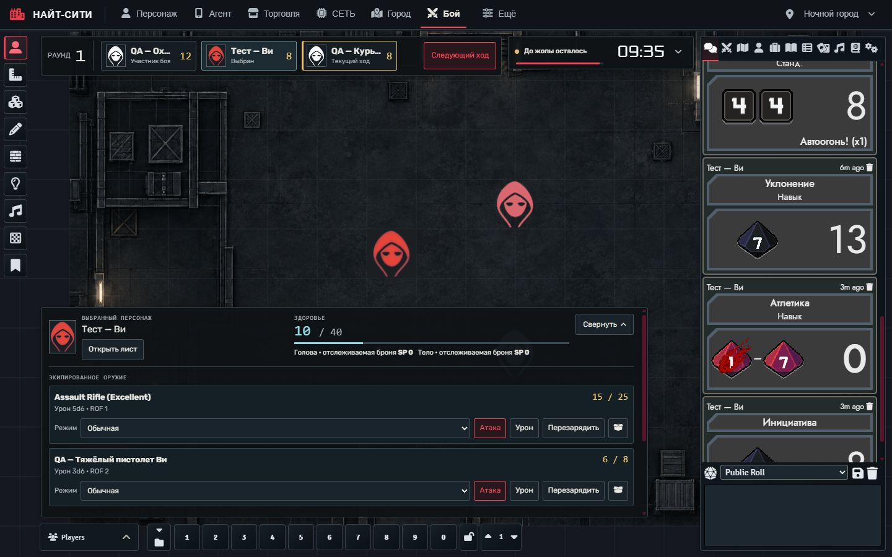
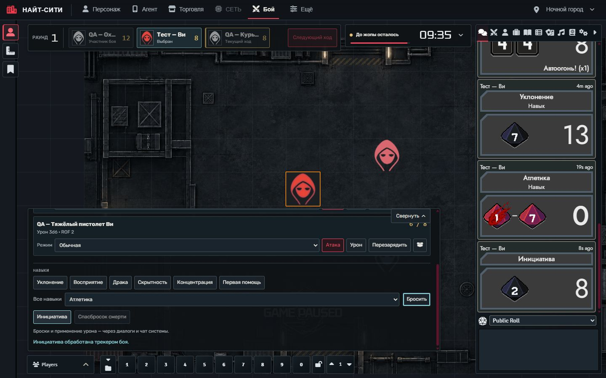

# Найт-Сити — общий интерфейс

**Версия 0.3.1 — Blackglass** для **Foundry VTT v12** и **Cyberpunk RED Core** (`cyberpunk-red-core`). Модуль добавляет общую навигацию, компактное оформление штатного интерфейса и согласованное расположение DEADLINE и REDLINE. Живая проверка выполнена на **Foundry 12.331 / CPR 0.92.4**.

[Релиз v0.3.1](https://github.com/Defaulter444/night-city-ui/releases/tag/v0.3.1) · [История изменений](CHANGELOG.md) · [Примечания к релизу](RELEASE-NOTES.md) · [Сообщить об ошибке](https://github.com/Defaulter444/night-city-ui/issues)



## Установка

В **Add-on Modules → Install Module → Manifest URL** вставьте:

```text
https://raw.githubusercontent.com/Defaulter444/night-city-ui/main/module.json
```

Установите пакет и включите **Найт-Сити — общий интерфейс** через **Manage Modules** в мире Cyberpunk RED. Перед обновлением рабочей кампании рекомендуется проверить модуль в отдельном тестовом мире.

Для ручной установки скачайте [night-city-ui.zip v0.3.1](https://github.com/Defaulter444/night-city-ui/releases/download/v0.3.1/night-city-ui.zip), остановите сервер и распакуйте папку `night-city-ui` в `Data/modules`, чтобы manifest оказался в `Data/modules/night-city-ui/module.json`. Перезапустите Foundry и включите модуль. При обновлении сохраните предыдущую папку для отката и замените её новой целиком.

Поддерживается только **Foundry v12**. Кроме системы Cyberpunk RED, интеграции необязательны: для действий персонажа нужен [REDLINE COMBAT 0.2.0](https://github.com/Defaulter444/CPR-RED-COMBAT), для таймера — DEADLINE. Отсутствующие модули не получают фиктивных рабочих команд. ZIP не содержит Foundry, систему, игровые миры или сторонние модули.

## Навигация и Blackglass

Верхнее меню подписано: **Персонаж / Агент / Торговля / СЕТЬ / Город GM / Бой**. Доступность пунктов зависит от установленных модулей и прав пользователя. Общая тема охватывает основные окна Agent, Market, Netrunning, Atlas и лист персонажа CPR; это не полный редизайн всех экранов каждого модуля.

В режиме **«Просторный интерфейс Foundry»**:

- Верхняя навигация занимает **48 px**. Имя сцены открывает исходное меню сцен Foundry с контекстными командами.
- Очередь инициативы REDLINE расположена одной горизонтальной строкой высотой **64 px**. Выбранный персонаж и текущий ход различаются.
- DEADLINE сворачивается до **54 px**, сохраняя собственные раскрытие и перетаскивание.
- Карточка персонажа занимает **540 × 80 px**. **«Действия»** раскрывает область с запрошенной высотой **340 px**; полоса целей добавляет **32 px**.
- Цели прокручиваются горизонтально в одну строку. При нехватке высоты раскрытая карточка ограничивается доступным местом и прокручивается вертикально; кнопка **«Свернуть»** остаётся доступной.

Инструменты слева раскрываются при наведении или фокусе клавиатуры, список игроков — над своей кнопкой. Макросы сохраняют десять ячеек, блокировку, каталог и страницы; на узком экране они переходят в два ряда. Сайдбар сохраняет вкладки и сворачивание. Минимальная проверенная ширина окна — **1024 px**.

## Действия персонажа

С REDLINE COMBAT 0.2.0 выберите своего персонажа и нажмите **«Действия»**. Под HP и бронёй доступны экипированное оружие, режим, **Атака / Урон / Перезарядить / Выбрать патроны**, быстрые навыки, список всех навыков, инициатива и спасбросок смерти.

Команды выполняет адаптер REDLINE для **CPR 0.92.4**. Атаки и урон открывают системные диалоги и карточки чата; боеприпасы используют штатные расход, `reload` и `load`. **Кнопка «Урон» не применяет его к цели автоматически** — применяйте результат штатными командами системы в чате. Недоступные действия имеют поясняющую подсказку, а выполняемая команда временно блокирует повторный запуск. Полный порядок работы описан в [руководстве REDLINE](https://github.com/Defaulter444/CPR-RED-COMBAT/blob/main/foundry/redline-combat/README.md).

Night City UI отвечает за оформление и положение панелей. Формулы боя, покупки, NET и игровые документы остаются у системы и исходных модулей. В сборке нет синхронных запросов защиты между клиентами и автоматизации NET.



## Личные настройки и возврат к исходному интерфейсу

Меню **«Ещё»** содержит личные настройки просторного интерфейса, общей темы, повторных значков и контекстных боевых панелей. **Alt + N** открывает меню; после выключения слоя через него можно снова включить интерфейс.

**«Ещё» → «Вернуться к исходному интерфейсу»** отключает оформление и навигационный слой без перезагрузки мира. Полное отключение выполняется через **Manage Modules**. Состояние раскрытия карточки сохраняется для текущего клиента. В контекстном режиме карточка появляется по игровой ситуации; при отключённом контекстном режиме назначенный персонаж может оставаться видимым вне боя и без выделенного токена.

Для отката версии отключите модуль, остановите сервер и восстановите сохранённую папку предыдущей сборки. Не смешивайте файлы релизов. Отключение оформления не отменяет игровые действия, выполненные через систему или REDLINE.

## Проверки и границы совместимости

Пройдены **29 автоматических тестов Night City UI** и **76 тестов REDLINE**. Совместная работа проверена в живом Foundry **12.331 / CPR 0.92.4** под **Player и Gamemaster**, на **1440 × 900** и **1024 × 768**. Проверены доступность действий и прокрутки, компактная карточка, штатные диалоги и сохранение доступа к макросам.

Ветки ближнего боя и успешного спасброска смерти в REDLINE покрыты автоматическими тестами, без отдельного живого сценария в этом проходе. Адаптер действий ограничен CPR 0.92.4. Foundry v13+, другие версии системы, окна уже 1024 px и произвольные сочетания сторонних тем не входят в проверенный набор. Карта, здоровье, боезапас, язык штатных подписей и игровые данные не подменяются оформлением; демонстрационная сцена в модуль не входит.

Для проверки кода из корня репозитория:

```sh
npm test
```

Зависимости npm для запуска модуля и этих тестов не нужны. Используйте современный Node.js с поддержкой ES modules и встроенного test runner.
